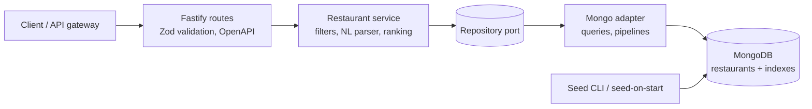

# restaurant-discovery-mongodb

Restaurant discovery API for BiteExpress, backed by MongoDB. Built as the MVP for the FDE take-home.

All four endpoints from the brief are implemented, tested (unit, integration against a real MongoDB,
and a Docker smoke test in CI) and documented. Interactive OpenAPI docs are served at `/docs`.

## Architecture



A stateless modular monolith: one container, no local state, so it scales horizontally behind a
load balancer. The service layer never sees HTTP or the MongoDB driver; the database sits behind a
repository interface, which is what keeps the on-prem/other-cloud migration a configuration change
(`MONGODB_URI`) rather than a rewrite. Decisions are recorded in [`docs/adr/`](docs/adr).

## Run with Docker

```bash
docker compose up --build        # API on :3000, MongoDB replica set on :27017
curl localhost:3000/health/ready
```

On first start the API creates indexes and, if the collection is empty, seeds it from
`data/zomato.csv` (full dataset, git-ignored) or else the committed `data/sample.csv`
(472 representative rows). Drop the Kaggle file at `data/zomato.csv` to load all 9,551.
Re-seed manually with `pnpm seed` (idempotent upsert on `tenantId + externalId`).

## API

| Endpoint                            | Purpose                                                       |
| ----------------------------------- | ------------------------------------------------------------- |
| `POST /v1/restaurants`              | Create; returns `201`, the entity and a `Location` header     |
| `GET /v1/restaurants/{id}`          | Full details; `404` if missing, `400` if the id is malformed  |
| `GET /v1/restaurants`               | Filter, sort and paginate; distance when `lat`/`lng` are sent |
| `GET /v1/restaurants/search`        | Natural-language query turned into the same filters           |
| `GET /health/live`, `/health/ready` | Liveness and readiness (MongoDB ping)                         |

`POST` is safe to retry: send an `Idempotency-Key` header (any unique string, up to 255 printable
characters, chosen by the client per logical create). Repeating the request with the same key returns
the original restaurant with `200` and `Idempotent-Replayed: true` instead of creating another;
the same key with a different body returns `409`. Without the header every call creates a new
restaurant; with an `externalId` a duplicate returns `409`. The key lives on the document behind a
partial unique index, so concurrent retries collapse into one insert.

List parameters: `name` (contains), `city`, `cuisine` (repeat or comma-separate, any-of), `minRating`,
`maxCost` (+ `currency`), `lat` + `lng` (+ `radiusKm`), `sort`
(`rating|-rating|name|-name|cost|-cost|distance`), `limit` (default 20, max 100), `offset` (max 5000).
Unknown parameters are rejected with `400`, which also blocks operator-injection attempts.

```bash
# best-rated South Indian places in Gurgaon
curl 'localhost:3000/v1/restaurants?city=gurgaon&cuisine=south%20indian&limit=5'
# nearest places within 3 km of a point
curl 'localhost:3000/v1/restaurants?lat=28.4595&lng=77.0266&radiusKm=3'
```

Design notes: `city`/`cuisine` input is canonicalised against a cached vocabulary of the stored
values (so `gurgaon`, `Gurugram` and `GURGAON` are equality matches that use the indexes, not
case-insensitive regexes); every sort ends in `_id` for stable pagination; `$geoNear` is used only
when a point is given, and other sorts then run in memory over the radius-bounded set; errors share
one envelope with a request id; indexes are reconciled with the declared set on every start.

## Natural-language search

`GET /v1/restaurants/search?q=...` turns free text into the same filters the list endpoint uses
(it is a parsing layer, not a second query path). The response echoes `interpretation` and
`unparsedTerms`, so you can always see what was understood.

```bash
curl -G localhost:3000/v1/restaurants/search --data-urlencode 'q=Best restaurants in Gurgaon with South Indian Food'
curl -G localhost:3000/v1/restaurants/search --data-urlencode 'q=Restaurants in Gurgaon under Rs. 1000 for two'
curl -G localhost:3000/v1/restaurants/search --data-urlencode 'q=Nearest place that serves Vada Pav' \
  -d 'lat=28.4595&lng=77.0266'
```

| The text says                                                      | It becomes                                                    |
| ------------------------------------------------------------------ | ------------------------------------------------------------- |
| a known city (`gurgaon`, `Gurugram`, `delhi`)                      | `city` (aliases resolve to the stored spelling)               |
| a known cuisine, singular or plural                                | `cuisine` filter (any-of)                                     |
| `under/below/max/up to` + amount (`Rs`, `₹`, `1.5k`, `per person`) | `maxCost` (+ currency; per-person is doubled)                 |
| `rated above 4`, `4+ stars`, `at least 3.5`                        | `minRating`                                                   |
| `nearest`, `closest`, `near me`, `nearby`                          | sort by distance (needs `lat` and `lng`, else a clear `400`)  |
| `within 3 km`, `within 500 m`                                      | `radiusKm` (needs `lat` and `lng`)                            |
| `best`, `top rated`, `highly rated`                                | sort by weighted score (see below)                            |
| `cheap` / `cheapest`                                               | price range <= 2 / sort by cost                               |
| a dish (`vada pav`, `dosa`, `biryani`...)                          | name match, plus a cuisine only where the cuisine is the dish |
| anything unrecognised                                              | name search, listed in `unparsedTerms`                        |

Explicit parameters (`city`, `cuisine`, `maxCost`, `sort`, ...) override what was parsed.

**"Best" is not "highest average".** A 5.0 from 3 votes should not beat a 4.5 from 300, so it
ranks by the Bayesian weighted score `v/(v+m) * R + m/(v+m) * C` (R = rating, v = votes,
C = mean rating of all rated restaurants, m = `RANKING_MIN_VOTES`, default 100; the dataset's median
is about 60 votes). Only rated restaurants take part, and the score is returned with each result.
The formula is computed in MongoDB and checked against a plain TypeScript implementation in tests.

**Honest limits**

- The dataset has cuisines, not dishes. "Vada pav" matches restaurants _named_ that (the data has
  such places, all typed `Street Food`); it deliberately does not return every street-food stall.
  A dish with no matching name returns nothing rather than something unrelated.
- A currency is assumed (`DEFAULT_CURRENCY`, default `INR`) when an amount names none; `$` means USD.
- Free-text name search is a case-insensitive regex, because `$text` cannot be combined with
  `$geoNear`. It is bounded by the other filters; Atlas Search would replace it.
- The weighted sort runs in memory over the filtered set (fine at this scale; a precomputed
  score field would be the next step).
- The parser sits behind a `QueryParser` interface, so an LLM-backed parser that fills the same
  structure (validated, with this one as fallback) can be added without touching the rest.

## Data cleaning decisions

| Source quirk                                               | Handling                                                         |
| ---------------------------------------------------------- | ---------------------------------------------------------------- |
| File is not valid UTF-8 (some names are mojibake)          | Strict UTF-8 first, Latin-1 fallback; corrupted names kept as is |
| `Currency` column is wrong (Philippines = "Botswana Pula") | Currency derived from the country code                           |
| 497 rows with `0,0` coordinates                            | `location` omitted, never stored as 0,0                          |
| 2,148 unrated rows (rating 0)                              | `rating.average` omitted so 0 does not skew averages; votes kept |
| 18 rows with cost for two = 0                              | `pricing.averageCostForTwo` omitted                              |
| 9 rows with no cuisines                                    | `cuisines: []`                                                   |
| Comma-separated `Cuisines` string                          | Trimmed, de-duplicated array (multikey index)                    |

Lat/lng become a GeoJSON `Point` as `[longitude, latitude]` for the `2dsphere` index.

## Design decisions and trade-offs

| Decision                            | Why                                                               | Cost                                                     |
| ----------------------------------- | ----------------------------------------------------------------- | -------------------------------------------------------- |
| Modular monolith, not microservices | One team, one small domain; fewer moving parts to run and debug   | Split later along module boundaries if load demands it   |
| Single `restaurants` collection     | Reads are always whole-restaurant; no joins needed                | Reviews/menus would need their own collections           |
| Compound indexes led by `tenantId`  | Multi-tenant from day one; every query is index-served            | Slightly larger indexes                                  |
| Rule-based NL parser, not an LLM    | Deterministic, free, fast, testable; interpretation is echoed     | Narrower phrasing coverage; LLM parser can slot in later |
| Bayesian weighted "best" score      | Stops 5.0-from-3-votes beating 4.5-from-300                       | Computed in memory over the filtered set                 |
| Native driver, no ODM               | Aggregation and geo pipelines are first-class; fewer abstractions | Hand-written queries (kept in one file, unit-tested)     |
| In-memory rate limiting             | No extra infrastructure for the MVP                               | Per instance; use a shared store or the gateway at scale |

## Multi-tenant, multi-country, peak hours, migration

What is built:

- **Multi-tenant:** every document carries `tenantId` and every index starts with it, so one cluster
  can hold many businesses. The tenant is currently fixed per deployment (`TENANT_ID`); taking it
  from an auth token is the next step and touches only the route layer.
- **Multi-country:** documents store `address.countryCode`, and currency is derived from it
  (`src/shared/countries.ts`, a small table to extend). The list endpoint does not yet filter by country.
- **Peak hours:** instances are stateless, so they scale horizontally. Queries are index-backed (query
  plans are asserted in integration tests), bounded by `maxTimeMS`, paginated with hard caps
  (`limit` 100, `offset` 5000, `radiusKm` 500), and vocabulary and rating statistics are cached.
- **On-prem or another cloud:** the app needs only a MongoDB connection string and env vars; the image
  is a plain non-root container with no vendor-specific services.
- **Behind a gateway:** set `TRUST_PROXY` so rate limiting sees client IPs; use gateway-level limits
  when running several instances.

Designed for, not built: read preference for secondary reads, zone sharding on
`{tenantId, countryCode}`, change-data-capture or dual writes while the relational monolith is
retired, and per-region clusters for data-residency rules.

## Testing

- **Unit (`pnpm test:unit`):** parser, ranking maths, query builders, cleaning, routes (with an
  in-memory fake repository), config, OpenAPI.
- **Integration (`pnpm test:integration`):** real MongoDB via Testcontainers (needs Docker): seed,
  index reconciliation, filters, paging, geo ordering and distance, query plans (`IXSCAN`,
  `GEO_NEAR_2DSPHERE`), search end to end.
- **Smoke (`pnpm test:e2e`):** run against the built Docker image in CI.
- **Coverage:** `pnpm test:coverage` enforces thresholds. **Architecture:** `pnpm deps:check`
  (dependency-cruiser) and `pnpm knip` (unused code) run in CI too.

## Known limitations and next steps

- No authentication; a gateway or JWT plugin is expected in front.
- Dish search matches names only, since the dataset has no dishes (see above).
- Name search is a regex (bounded by other filters); Atlas Search or a text index per tenant would
  be the upgrade for fuzzy matching at scale.
- No update/delete endpoints (not in the brief). `POST` without an `externalId` or an
  `Idempotency-Key` is not protected against duplicates, by design (see above).
- No country filter on list/search yet.
- Not set up in this repo: branch protection rules, secret scanning (e.g. gitleaks) and a devcontainer.

## Quick start (without Docker)

```bash
nvm use            # Node 22
corepack enable    # pnpm
pnpm install
pnpm dev           # http://localhost:3000/health/live
```

## Commands

| Command                     | Purpose                                                    |
| --------------------------- | ---------------------------------------------------------- |
| `pnpm check`                | format, lint, architecture, unused code, types, unit tests |
| `pnpm lint` / `lint:fix`    | ESLint (type-aware, strict)                                |
| `pnpm format`               | Prettier                                                   |
| `pnpm test:unit`            | Fast unit tests                                            |
| `pnpm test:integration`     | Real MongoDB via Testcontainers (needs Docker)             |
| `pnpm test:coverage`        | All tests with coverage thresholds                         |
| `pnpm test:e2e`             | Smoke test against a running instance                      |
| `pnpm deps:check` / `knip`  | Layering rules / unused exports and dependencies           |
| `pnpm seed`                 | Load the CSV (idempotent)                                  |
| `pnpm build` / `pnpm start` | Compile to `dist/` and run                                 |

## Conventions (enforced by tooling, not by memory)

- **Commits:** Conventional Commits, validated by commitlint (`type(scope): subject`, max 72 chars).
  Allowed scopes: restaurants, search, seed, infra, docker, config, deps, ci, tooling, docs.
- **Hooks (Husky):** `pre-commit` runs lint-staged (ESLint + Prettier on staged files),
  `commit-msg` runs commitlint, `pre-push` runs typecheck and unit tests.
- **CI is the real gate:** GitHub Actions repeats format, lint, architecture, typecheck, tests with
  coverage thresholds, build, and a Docker smoke test. PR titles are checked too.
- **Layering:** `routes -> service -> repository (interface)`. Only `*.mongo-repository.ts`,
  `src/infra/` (and scripts/tests) may import `mongodb`; `process.env` is read only in `src/config/`.
  Violations fail ESLint and dependency-cruiser. See [CONTRIBUTING.md](CONTRIBUTING.md).

## Tools and resources used

- Claude (Anthropic) was used as a coding assistant for planning, scaffolding, implementation and
  documentation, driven step by step by the author. Architecture choices (modular monolith, rule-based
  search instead of an LLM, weighted ranking, tooling) were reviewed and decided by the author; all
  code is reviewed and owned by the author, and an independent review pass checked it against the brief.
- Dataset: Zomato Restaurants (Kaggle). Stack: Fastify, Zod, MongoDB driver, Vitest, Testcontainers.
